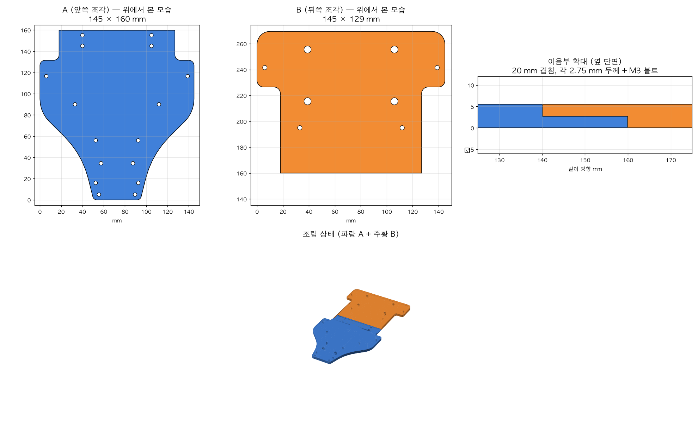

# f1tenth-car-build

F1TENTH(RoboRacer) 실차 제작 기록. **Traxxas Slash 4x4 + Jetson Orin NX** 기준으로 상판 3D 프린팅, 조립 가이드 요약, 부품 확인 사항을 정리한다.

- 목표 대회: F1TENTH(RoboRacer) 부산대 대회 (2027-01 하순 예상), KRoC 2027 Robot Competition (2027-02-14~17)
- 시뮬레이션·주행 알고리즘(Gap-follow, Pure Pursuit, MAP)은 별도 저장소: [jinchan1203/f1tenth-sim](https://github.com/jinchan1203/f1tenth-sim)

## 진행 상황

| 단계 | 상태 |
|---|---|
| 차체 선정 | ✅ Traxxas (Slash 4x4 기준) |
| 컴퓨터 | ✅ Jetson Orin NX (추정, 캐리어보드 확인 필요) |
| 상판 도면 선정 | ✅ UNICORN Racing `F1tenth_Orin_NX` (Traxxas + Orin NX + VESC) |
| 상판 분할 (256 mm 베드용) | ✅ 하프랩 이음 + M3 볼트 4개 |
| 상판 3D 프린팅 | ✅ 앞판·뒷판 PETG-CF 출력 |
| 아래층 차체 분해 (기존 전장 제거) | 🔄 진행 중 |
| 스탠드오프·나사 | ⬜ 미보유 → 구매 필요 ([docs/parts_check.md](docs/parts_check.md)) |
| 배터리 | ⚠️ 2S 7.4V 보유 → 3S 필요 여부 확인 ([docs/parts_check.md](docs/parts_check.md)) |
| LiDAR | ⬜ 기종 미정 |
| VESC·파워보드 | ⬜ 모델·입력전압 확인 필요 |
| 배선·첫 전원 | ⬜ |
| 소프트웨어 (ROS 2 Humble, f1tenth_system) | ⬜ |

## 구성

```
hardware/upper_plate_orin_nx/
  original/F1tenth_Orin_NX.stl       원본 상판 (UNICORN Racing, CC BY 4.0) 145×270×5.5 mm
  split/F1tenth_Orin_NX_A_front.stl  분할 앞판 (원본 좌표)
  split/F1tenth_Orin_NX_B_rear.stl   분할 뒷판 (원본 좌표)
  print/print_A_front.stl            출력용 앞판 (눕힘, 그대로 출력)
  print/print_B_rear.stl             출력용 뒷판 (뒤집어 둠, 그대로 출력)
  print/upper_plate_PETG-CF.3mf      Bambu Studio 프로젝트 (X2D, PETG-CF, 플레이트 2장)
  print/upper_plate_B_rear_PETG-CF.3mf  뒷판만
  split_preview.png                  분할 결과 그림
docs/
  build_guide.md                     RoboRacer 공식 조립 가이드 요약 (한국어)
  printing.md                        상판 분할·3D 프린팅 방법 (Bambu Lab)
  parts_check.md                     배터리·스탠드오프·VESC 등 확인 사항
tools/
  split_plate.py                     STL을 하프랩 이음으로 2분할 + M3 볼트 구멍
  render_split.py                    분할 결과 미리보기 그림
  probe_plate.py                     판 외곽·구멍·길이별 폭 분석 (자를 위치 찾기)
  make_bambu_presets.py              Bambu Studio CLI용 X2D 프리셋 생성
```

## 상판 분할 요약



- 원본 145 × 270 mm → 256 × 256 mm 베드(Bambu X2D 등)에 안 들어감 (45° 대각선도 252 mm 필요해 여유 2 mm뿐)
- 기존 구멍이 없는 폭 109 mm 구간(길이 140~160 mm)에서 **20 mm 하프랩**으로 분할
  - 앞판 A: 145 × 160 mm, 뒷판 B: 145 × 129 mm
  - 겹침부 각 2.75 mm 두께, **M3 볼트 구멍 4개** (Ø3.4), 계단 끝 틈새 0.2 mm
- 조립: M3×10 볼트·너트 4세트 + 접착제(에폭시/CA) 권장

자세한 방법은 [docs/printing.md](docs/printing.md).

## 출처·라이선스

- 상판 원본 도면: [UNICORN Racing (UNIST HMCL) — Upper Plate 설계 및 장착 가이드 (Traxxas + Orin NX + VESC)](https://hmcl-unist.github.io/unicorn-racing/posts/upper-plate-traxxas-orin-nx-vesc/), **CC BY 4.0**, by Yunho Lee. 이 저장소의 분할·출력용 STL과 3MF는 이를 수정한 파생물이다.
- 조립 가이드 요약: [RoboRacer 공식 문서](https://f1tenth.readthedocs.io/en/main/getting_started/build_car)
