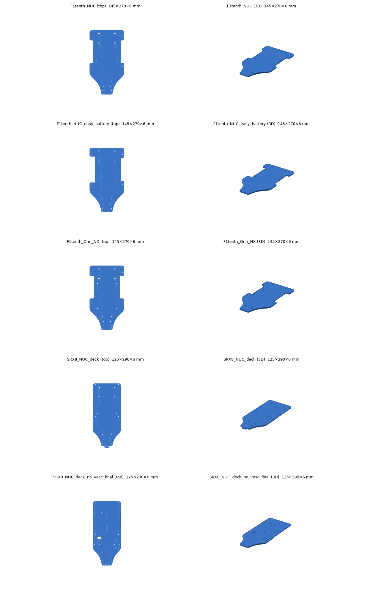

# 상판 분할·3D 프린팅

## 도면 고르기

[UNICORN Racing 블로그 3d-printing 태그](https://hmcl-unist.github.io/unicorn-racing/tags/3d-printing/)의 Upper Plate 5종:

| 차체 + 컴퓨터 | 파일 | 크기 |
|---|---|---|
| **Traxxas + Orin NX + VESC** ← 사용 | `F1tenth_Orin_NX` | 145×270×5.5 mm |
| Traxxas + NUC + VESC | `F1tenth_NUC`, `F1tenth_NUC_easy_battery` | 145×270×5.5 mm |
| SRX + NUC + VESC | `SRX8_NUC_deck` | 125×290×5.5 mm |
| SRX + NUC (VESC 없음) | `SRX8_NUC_deck_no_vesc_final` | 125×290×5.5 mm |



출력 전 확인: 컴퓨터 캐리어보드 나사 위치, 차체 스탠드오프 위치를 원래 판·종이 1:1 인쇄로 대보기.

## 분할

256 × 256 mm 베드에는 270 mm 판이 안 들어감. `tools/probe_plate.py`로 길이별 폭·구멍 위치를 보고,
구멍이 없는 폭 109 mm 구간 가운데(길이 150 mm)에서 하프랩으로 자름.

```bash
python3 -m venv venv && venv/bin/pip install trimesh manifold3d shapely scipy networkx rtree matplotlib numpy
venv/bin/python tools/probe_plate.py original.stl
venv/bin/python tools/split_plate.py original.stl A.stl B.stl preview.png   # 분할 중심·겹침·볼트 위치는 스크립트 상단 상수
venv/bin/python tools/render_split.py A.stl B.stl split_preview.png
```

- 겹침 20 mm, 각 조각 겹침부 두께 2.75 mm, 계단 끝 틈새 0.2 mm
- M3 여유 구멍 Ø3.4 × 4개 (x=40/105, 길이 145/155 mm)

## 출력 방향 (중요)

- **앞판 A**: 겹침부가 아래쪽 절반 → 그대로 눕혀 출력
- **뒷판 B**: 겹침부가 위쪽 절반 → **뒤집어서** 출력 (안 그러면 20 mm가 공중에 뜸)
- `print/` 폴더의 STL은 이미 이 방향으로 놓여 있음 (아래로 향한 면이 전부 베드에 닿는 것 확인)

## Bambu Lab X2D 설정

- 베드 256 × 256 mm (노즐 하나 기준), 노즐 0.4 mm × 2
- 필라멘트: PETG-CF (프린터에 꽂힌 것과 같은 재료 선택)
- 베드: Textured PEI Plate
- 권장: 벽 4, 위·아래 쉘 5, 내부 채움 40% Gyroid, 브림 Auto, 서포트 끔
- 한 판씩 출력 (A와 B를 나란히 놓으면 290 mm라 같이 안 들어감)

`print/upper_plate_PETG-CF.3mf`는 위 설정을 넣어 CLI로 만든 프로젝트 (플레이트 1 = 앞판, 2 = 뒷판).
CLI 슬라이스 결과: 앞판 약 128분·67 g, 뒷판 약 118분·62 g.

> **알려진 문제**: 이 3MF를 Bambu Studio GUI에서 열어 다시 슬라이스하면 뒷판이 1h12m·42.7 g으로 나와서,
> 강화 설정(벽 4, 채움 40%)이 기본값(벽 2, 채움 15%)으로 돌아간 것으로 보인다 (프리셋 이름을 시스템 프리셋과 같게 저장했기 때문으로 추정, 미확인).
> GUI에서 출력하기 전에 프로세스 설정 값을 직접 확인할 것.

### CLI로 프로젝트 만들기

```bash
python3 tools/make_bambu_presets.py <출력폴더>     # machine/process/filament JSON (상속 풀고 강화 설정 적용)
/Applications/BambuStudio.app/Contents/MacOS/BambuStudio \
  --load-settings "<폴더>/machine.json;<폴더>/process.json" --load-filaments "<폴더>/filament.json" \
  --arrange 1 --slice 0 --outputdir out --export-3mf plate.3mf print_A_front.stl print_B_rear.stl
```

- `curr_bed_type`을 지정하지 않으면 Cool Plate로 잡혀 `Cool Plate does not support filament` 오류 → 스크립트에서 Textured PEI로 설정
- 결과 `out/result.json`의 `warning_message`에 `floating cantilever`가 있으면 출력 방향이 틀린 것

## 프린터 연결

- USB 메모리: 슬라이스 → "Export plate sliced file" → 프린터 "USB 스토리지"
- 무선: 같은 와이파이 + 프린터가 다른 계정에 등록돼 있으면 **LAN 모드(프린터 화면의 액세스 코드)** 로 연결
  - 공용 프린터의 계정 등록을 바꾸면 다른 사용자가 못 쓰게 되므로 관리자 허락 없이 바꾸지 않기

## 조립

M3×10 볼트·너트 4세트, 겹침면에 에폭시/CA 접착제. 구멍이 빡빡하면 3 mm 드릴로 정리.
이음 바로 위에는 무거운 부품(Orin, VESC)을 두지 않는 것이 좋음.
